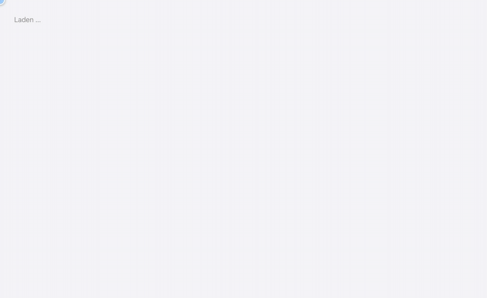

# Installation and operation

[Deutsch](INSTALL.md) · [Français](INSTALL.fr.md) · [Italiano](INSTALL.it.md) · **English**

- [Try it with Docker](#try-it-with-docker)
- [Development](#development)
- [First setup](#first-setup)
- [Running on a server](#running-on-a-server)
- [Settings](#settings)
- [Before going live](#before-going-live)
- [Browser demo (GitHub Pages)](#browser-demo-github-pages)
- [Tests](#tests)

## Try it with Docker

Requirement: [Docker](https://docs.docker.com/get-docker/) with Compose.

```bash
git clone https://github.com/dllb-ch/WK-Planer.git
cd WK-Planer
docker compose up -d --build
```

Then open <http://localhost:8080>. This quick-start configuration fills the empty database with a sample refresher
course on first start (`SEED_DEMO=1`; the demo data is in German).
Sign in with a demo account, password `zivilschutz`:

| Role | Email |
|---|---|
| Battalion command | `bat@demo.ch` |
| Company commander | `kpkdt@demo.ch` |
| Platoon leader | `zfhr1@demo.ch` (Pi Z 1), `zfhr2@demo.ch`, `zfhr3@demo.ch`, `zfhrlog@demo.ch` |
| Cadre (group leader) | `kader@demo.ch`, `kader2@demo.ch` |
| Logistics officer | `logof@demo.ch` |
| Org admin (templates) | `admin@demo.ch` |

With demo accounts you can switch roles at the top right. Stop with `docker compose down`
(`docker compose down -v` also deletes the data).

## Development

Requirements: [Node.js](https://nodejs.org) 22.13 or later; Docker is optional.

```bash
npm install
npm run dev        # API on :3001, app on http://localhost:5173 (with live reload)
```

Without further settings, the server stores its data with [PGlite](https://pglite.dev) (PostgreSQL as WebAssembly)
in the folder `server/data/pglite` – no database server is needed. With your own PostgreSQL:

```bash
docker compose up -d db                                                     # PostgreSQL 16 on 127.0.0.1:54329
echo 'DATABASE_URL=postgres://zs:zs@127.0.0.1:54329/zs' > server/.env
npm run dev
```

An empty database opens the [setup](#first-setup) in the browser; `SEED_DEMO=1 npm run dev` fills it with the demo
data instead. `npm run seed` resets the database to the demo data.

The schema is in `server/src/sql/schema.sql` and is created or extended on start (`… IF NOT EXISTS`).
SQL is written with `?` placeholders; `server/src/db.ts` translates them for PostgreSQL.

## First setup

Instead of the login, an empty installation shows a wizard that creates the organisation in one go:

<p align="center"></p>

1. **Battalion:** name, region, document letterhead (office, department, address, phone, website) and logos.
2. **Companies and platoons** with the target strength per platoon (platoon leaders, cadre, soldiers).
3. **People:** your own account (battalion command) and, if you like, company commanders and platoon leaders with a
   shared initial password, which they change under "My account".
4. **Resources:** vehicles, trailers, rooms and sites – per company or for the battalion.
5. **Map:** the area in which all maps open.

You are then signed in as battalion command; the preparation timeline is created from the standard template.
Everything else (groups, cadre, logistics officer, site areas, your own templates) follows under "Organisation".
Instead of your own organisation you can also load the demo. As soon as an account exists, the setup is locked.

The wizard appears in the browser's language; standard texts (preparation timeline, briefing agendas) are created in
that language.

If an empty installation is publicly reachable, `SETUP_TOKEN` should be set: the wizard then asks for this code, so
that nobody else sets up the installation first.

## Running on a server

The `Dockerfile` builds the app; the server delivers it. For a server with HTTPS, `deploy/` contains a template for
[Traefik](https://traefik.io) with the app and PostgreSQL. It expects a Docker network `proxy` shared with Traefik,
the entrypoints `http`/`https` and a middleware `redirect-https` – for other names, adjust the labels in
`deploy/docker-compose.yml`.

```bash
cd deploy
cp .env.example .env          # enter domain, passwords and certificate resolver
docker compose up -d --build  # also after every code update
docker compose logs -f app
```

Backing up and restoring the database:

```bash
docker compose exec db pg_dump -U zs zs | gzip > backup-$(date +%F).sql.gz
gunzip -c backup-2026-11-05.sql.gz | docker compose exec -T db psql -U zs zs
```

Without Traefik, the `docker-compose.yml` in the main folder is enough behind any reverse proxy with HTTPS
(port 8080, set `TRUST_PROXY=1`).

## Settings

| Variable | Meaning |
|---|---|
| `DATABASE_URL` | PostgreSQL connection; without it the server uses PGlite in `PGLITE_DIR` |
| `PGLITE_DIR` | Folder of the PGlite database (default `server/data/pglite`) |
| `API_PORT` | Server port (default 3001, 8080 in the container) |
| `GATE_PASSWORD`, `GATE_USER` | Optional password protection (HTTP Basic Auth) in front of the whole app; QR check-in stays open. After 10 failed attempts an address is blocked for 15 minutes |
| `TRUST_PROXY` | `1` behind a reverse proxy (correct addresses for login lockouts) |
| `SETUP_TOKEN` | Code for the [first setup](#first-setup) of an empty installation |
| `SEED_DEMO` | `1`: fill an empty database with the demo data on start instead of showing the setup |
| `DOMAIN`, `TRAEFIK_CERTRESOLVER`, `POSTGRES_PASSWORD` | Only for `deploy/docker-compose.yml` |

For development the variables go in `server/.env`, on the server in `deploy/.env`.

## Before going live

1. Start with an empty database and run through the [first setup](#first-setup) – or, if you started with demo data,
   delete the demo accounts or change their passwords ("Organisation › Companies & personnel").
2. Add groups, further users (cadre, logistics officer) and templates.
3. Set the letterhead, address and logos under "Organisation › Templates & resources", as well as vehicles, rooms
   and sites.
4. For check-in by phone, the app must be reachable at an address the phones can open (under `localhost` the app
   shows a notice).
5. Set up regular database backups.

## Browser demo (GitHub Pages)

`npm run build:demo` builds a version in which the server runs in the browser: PGlite stores the data in the
browser's IndexedDB, and the page itself answers requests to `/api/…` (`client/src/demo/`). Every visitor has their
own demo data; "Reset demo" (bottom left) starts over. The login page signs in as a role with one click. Not
included are the password protection in front of the app and check-in from another device (the QR code points to
the same browser).

The workflow `.github/workflows/pages.yml` publishes the demo on every push to `main`. Once, under
*Settings › Pages › Source*, choose "GitHub Actions". To try it locally:

```bash
npm run build:demo
npm run preview -w client -- --mode demo      # http://localhost:4173/WK-Planer/
```

## Tests

```bash
npm test             # Vitest: permissions, planning rules and API (in-memory PGlite, fresh for each test)
TEST_DATABASE_URL=postgres://… npm test   # the same tests against a PostgreSQL server (the schema is emptied!)
npm run typecheck
npm run test:e2e     # Playwright (once beforehand: npx playwright install chromium)
```

The animations in the README are made with `docs/media/record.mjs` from a demo instance (instructions at the top of
the file).
