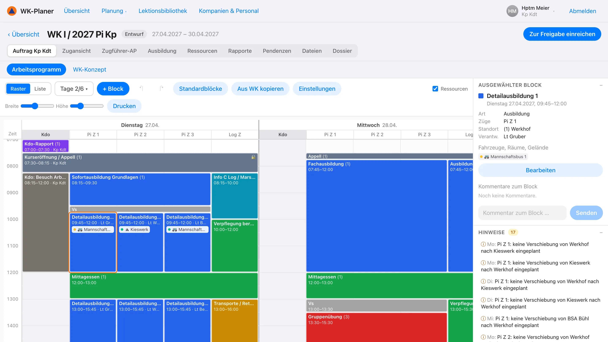
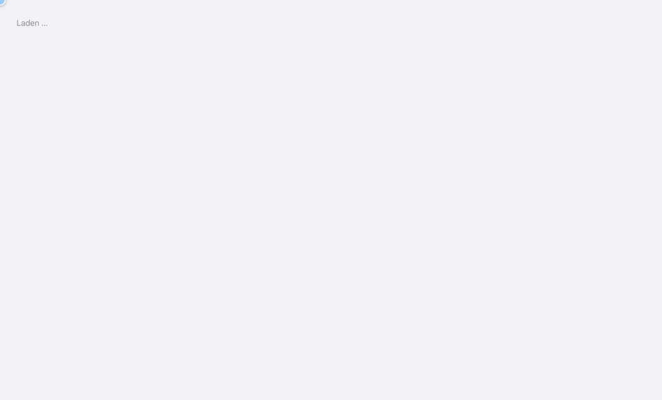
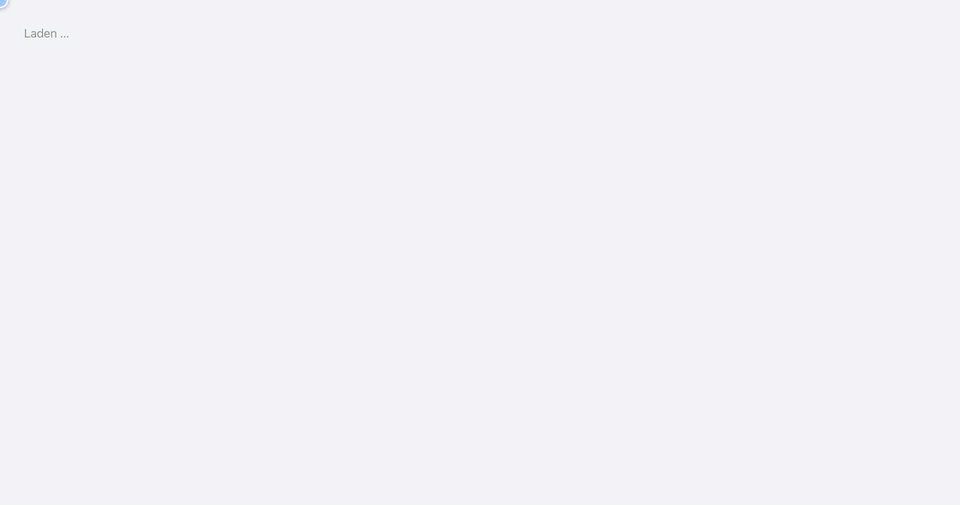
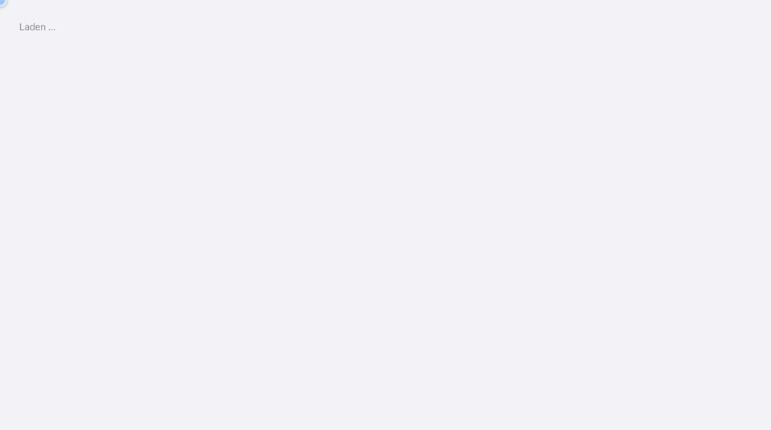
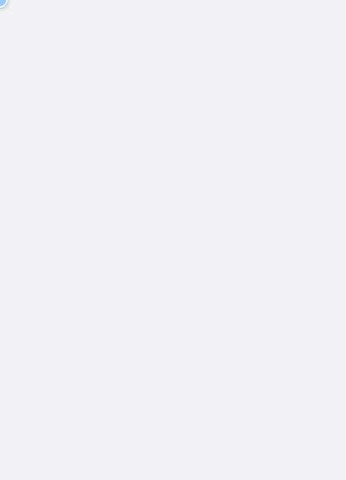

<div align="center">


# WK-Planer Civil Protection

**Plan refresher courses in Swiss civil protection – from the training order to check-in.**

[Deutsch](README.md) · [Français](README.fr.md) · [Italiano](README.it.md) · **English**

[](https://dllb-ch.github.io/WK-Planer/)
&nbsp;
[](LICENSE)


[Features](#features) · [Quick start](#quick-start) · [Installation](INSTALL.en.md) · [Handbook (German)](docs/handbuch.md)

</div>

<br>

<picture>
  <source media="(prefers-color-scheme: dark)" srcset="docs/media/arbeitsprogramm-dark.webp">
  
</picture>

<br>

Built on the *Handbuch Führung im Zivilschutz* (civil protection command handbook) of the Federal Office for Civil
Protection (FOCP). Several people plan at the same time, each role with its own permissions:

| 🎖️ Battalion command | 🧭 Company commander | 📦 Logistics officer | 🗂️ Platoon leader | 👥 Cadre |
|:---:|:---:|:---:|:---:|:---:|
| Training order, annual planning, approval | Refresher course concept, work programme, personnel | Logistics, requests for vehicles and rooms | Own platoon's programme, lessons | Read own programme |

Runs in the browser on computer, tablet and phone, installs as an app, works in light and dark mode and speaks
German, French, Italian and English.

> [!TIP]
> **[Try the demo in your browser →](https://dllb-ch.github.io/WK-Planer/)** – no installation, no account: pick a
> role and start. The demo runs entirely in the browser; changes stay on your device. The demo data is in German.

## Features

### 📱 QR code check-in

<table>
<tr>
<td width="62%" valign="middle">

One QR code per day of service to put up. Participants check in with their phone – **no account, in a few
seconds** – and answer the medical entry questionnaire on the way.

- Matched against the participant list
- Meals are counted (vegetarian too)
- Health reports go to the company commander
- From the second day on, one tap is enough

</td>
<td width="38%" align="center">

</td>
</tr>
</table>

### 📅 Annual planning

Preparatory work, cadre course and refresher course days for every company in a year. In the month view, the
battalion command plans days by dragging the mouse as in a spreadsheet – per platoon, per function (platoon leaders,
cadre, soldiers) or per group – with actual and target strength alongside.

<p align="center"></p>

### 🗓️ Work programme

The company's work programme as a grid: days with one column per platoon. Blocks are drawn, moved and resized;
platoon leaders plan their platoon, the command sets fixed blocks. The right-click menu duplicates, copies to the
next day, locks, or requests vehicles and rooms. Conflicts are shown.

<p align="center"></p>

### 🚐 Vehicles, rooms and sites

Platoon leaders request vehicles (by number of people), rooms and sites for their time slots; the company commander
approves and assigns. The occupancy plan shows usage and double bookings – across the battalion's companies too.

<p align="center"></p>

### 📝 Lesson preparation and dossier

Platoon leaders prepare their lessons right at the training block: objectives, training level, means and sequence
following PITT – the time check shows whether the programme fits the slot. From this comes the dossier as a PDF with
letterhead: for the company (cover page, mission, course concept, work programme, resources) or per platoon with the
platoon leader's work programme and all lessons.

<p align="center"></p>

### 🌗 On the go, light and dark

<table>
<tr>
<td width="38%" align="center">

</td>
<td width="62%" valign="middle">

The whole app also works on a phone – with a list view of the work programme, adapted navigation and large controls.

- Installable as an app (PWA), readable offline
- Light and dark mode following the system setting
- Same data and permissions as on the computer

</td>
</tr>
</table>

### 🌐 Deutsch, Français, Italiano, English

The whole interface is available in four languages, using the terms from the FOCP documents (e.g. WK / CR / CR,
Kp Kdt / cdt cp / cdt cp). Each account chooses its language under "My account"; the login and check-in pages can be
switched directly, so participants check in in their own language.

- Printouts such as the dossier and the daily order come out in the language of the person printing
- Server messages, briefing agendas and templates follow the chosen language too
- Content people enter stays as it was entered
- The terms used are listed in the [glossary](docs/glossar.md)

### Also included

<table>
<tr>
<td width="33%" valign="top">

**🔗 Planning chain**<br>
Training order → course concept → work programme → platoon leader's work programme, with a preparation timeline and
open items per role.

</td>
<td width="33%" valign="top">

**📚 Lessons**<br>
Lesson preparations with objectives, sequence and time check; the battalion's lesson library.

</td>
<td width="33%" valign="top">

**🧪 Exercises**<br>
Reconnaissance, exercises (concept, script, debrief) and an automatic daily order.

</td>
</tr>
<tr>
<td valign="top">

**📝 Briefings**<br>
Agendas following the handbook, minutes and open items.

</td>
<td valign="top">

**👥 Personnel**<br>
Target strength per platoon and day, participant list from Excel, attendance list, groups per platoon.

</td>
<td valign="top">

**🖨️ Dossier**<br>
All documents of a refresher course as a PDF with your own letterhead and logo.

</td>
</tr>
</table>

Readable offline as an installed app (PWA) – everything else is in the [handbook](docs/handbuch.md) (German).

## Quick start

```bash
git clone https://github.com/dllb-ch/WK-Planer.git
cd WK-Planer
docker compose up -d --build
```

Then open <http://localhost:8080> and sign in with `kpkdt@demo.ch` (password `zivilschutz`) – the app starts with a
sample refresher course and demo accounts for every role.

Or without Docker, right in the browser: [demo](https://dllb-ch.github.io/WK-Planer/).

Without demo data (leave out `SEED_DEMO`), a wizard guides you through the [first setup](INSTALL.en.md#first-setup):
battalion, companies and platoons, accounts, resources and map – in a few minutes.

<p align="center"></p>

## Documentation

- **[Installation and operation](INSTALL.en.md):** Docker, development, first setup, server with HTTPS, settings, tests
- **[Handbook](docs/handbuch.md) (German):** every feature and how to use it, by role

## Tech stack

- **Client:** React 18, TypeScript, Vite, TanStack Query, Tailwind CSS; installable as a PWA
- **Server:** Node.js, Express, zod, PostgreSQL (or PGlite)
- **Shared:** types and permissions in `shared/` – permissions are checked on the server and mirrored in the client
- **Languages:** typed catalogs in `shared/i18n/` (de, fr, it, en); a test checks that every language has every text

```
client/   user interface (planner: client/src/features/arbeitsprogramm/)
server/   API and database (schema: server/src/sql/schema.sql)
shared/   types, permissions, planning rules, translations
docs/     handbook and animations
```

## Contributing

Bugs and ideas are welcome as issues, changes as pull requests – with tests (`npm test`) and type checking
(`npm run typecheck`), see [INSTALL.en.md](INSTALL.en.md#tests).

WK-Planer is an independent project and not an official product of the FOCP or of any canton.

## License

[MIT](LICENSE)
