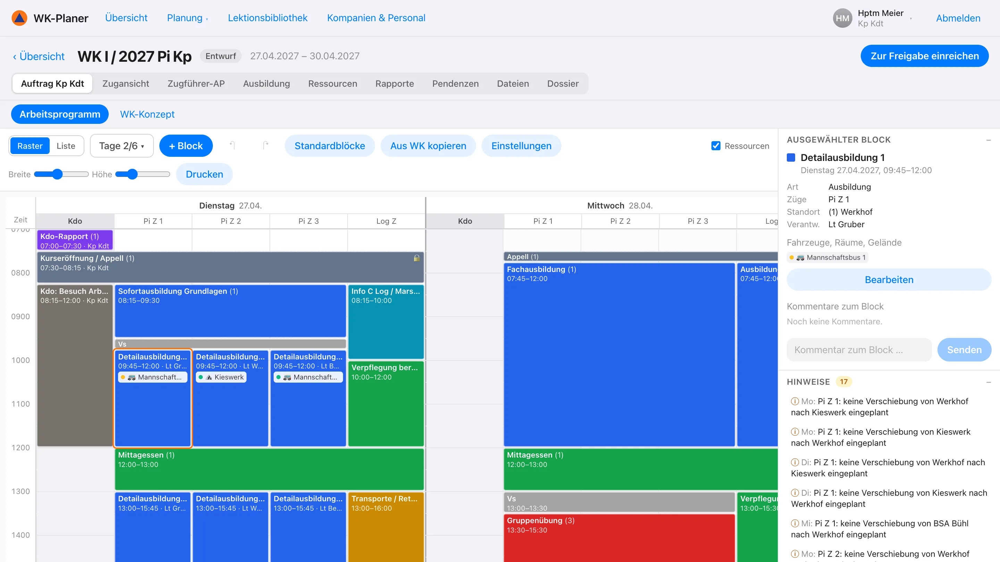
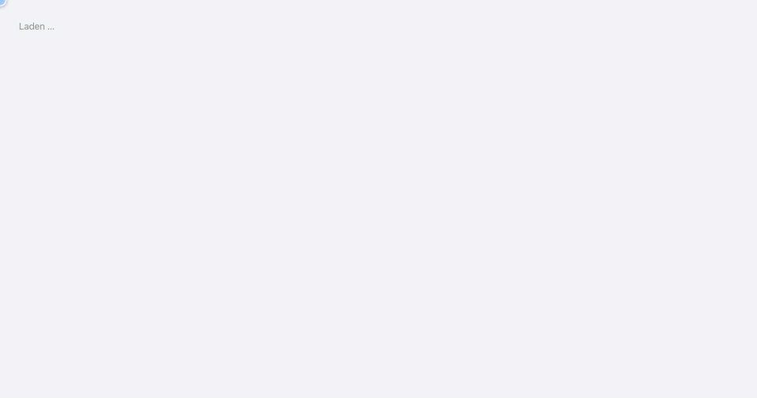
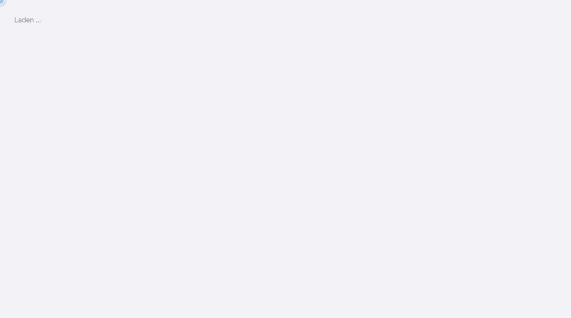
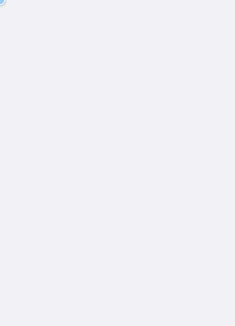

<div align="center">


# WK-Planer Protection civile

**Planifier les cours de répétition de la protection civile suisse – de l'ordre de formation jusqu'au check-in.**

[Deutsch](README.md) · **Français** · [Italiano](README.it.md) · [English](README.en.md)

[](https://dllb-ch.github.io/WK-Planer/)
&nbsp;
[](LICENSE)


[Fonctions](#fonctions) · [Démarrage rapide](#démarrage-rapide) · [Installation](INSTALL.fr.md) · [Manuel (en allemand)](docs/handbuch.md)

</div>

<br>

<picture>
  <source media="(prefers-color-scheme: dark)" srcset="docs/media/arbeitsprogramm-dark.webp">
  
</picture>

<br>

Conçu selon le *Manuel Conduite dans la protection civile* de l'Office fédéral de la protection de la population
(OFPP). Plusieurs personnes planifient en même temps, chaque rôle avec ses propres droits :

| 🎖️ Cdmt bat | 🧭 Cdt cp | 📦 Of log | 🗂️ Chef de section | 👥 Cadres |
|:---:|:---:|:---:|:---:|:---:|
| Ordre de formation, planification annuelle, approbation | Concept du CR, programme de travail, personnel | Logistique, demandes de véhicules et de locaux | Programme de sa section, leçons | Lire son propre programme |

Fonctionne dans le navigateur sur ordinateur, tablette et téléphone, s'installe comme une application, s'affiche en
mode clair et sombre et parle allemand, français, italien et anglais.

> [!TIP]
> **[Essayer la démo dans le navigateur →](https://dllb-ch.github.io/WK-Planer/)** – sans installation ni compte :
> choisir un rôle et commencer. La démo fonctionne entièrement dans le navigateur ; les modifications restent sur
> l'appareil. Les données de démonstration sont en allemand.

## Fonctions

### 📱 Check-in par code QR

<table>
<tr>
<td width="62%" valign="middle">

Un code QR par jour de service, à afficher. Les participants s'enregistrent avec leur téléphone – **sans compte, en
quelques secondes** – et répondent au passage au questionnaire sanitaire d'entrée.

- Comparaison avec la liste des participants
- Les repas sont comptés (végétariens compris)
- Les annonces de santé parviennent au cdt cp
- Dès le deuxième jour, un seul geste suffit

</td>
<td width="38%" align="center">

</td>
</tr>
</table>

### 📅 Planification annuelle

Les jours de PT, de CC et de CR de toutes les compagnies d'une année. Dans la vue mensuelle, le commandement du
bataillon planifie les jours en faisant glisser la souris comme dans un tableur – par section, par fonction (chefs de
section, cadres, soldats) ou par groupe – avec l'effectif réel et l'effectif réglementaire à côté.

<p align="center"></p>

### 🗓️ Programme de travail

Le programme de travail de la compagnie sous forme de grille : des jours avec une colonne par section. Les blocs se
dessinent, se déplacent et s'allongent ; les chefs de section planifient leur section, le commandement fixe des blocs
imposés. Le menu du clic droit duplique, copie au jour suivant, verrouille ou demande des véhicules et des locaux. Les
conflits sont signalés.

<p align="center"></p>

### 🚐 Véhicules, locaux et terrains

Les chefs de section demandent des véhicules (selon le nombre de personnes), des locaux et des terrains pour leurs
créneaux ; le cdt cp approuve et attribue. Le plan d'occupation montre l'utilisation et les doubles réservations –
aussi entre les compagnies du bataillon.

<p align="center"></p>

### 📝 Préparation des formations et dossier

Les chefs de section préparent leurs leçons directement dans le bloc de formation : objectifs, niveau de formation,
moyens et déroulement selon PITT – le contrôle du temps montre si le programme tient dans le créneau. Il en résulte le
dossier en PDF avec en-tête : pour la compagnie (page de titre, mission, concept du CR, programme de travail,
ressources) ou par section, avec le programme de travail du chef de section et toutes les leçons.

<p align="center"></p>

### 🌗 En déplacement, en clair et en sombre

<table>
<tr>
<td width="38%" align="center">

</td>
<td width="62%" valign="middle">

Toute l'application fonctionne aussi sur le téléphone – avec une vue en liste du programme de travail, une
navigation adaptée et de grands éléments de commande.

- Installable comme application (PWA), lisible hors ligne
- Mode clair et sombre selon le réglage du système
- Mêmes données et mêmes droits que sur l'ordinateur

</td>
</tr>
</table>

### 🌐 Deutsch, Français, Italiano, English

Toute l'interface existe en quatre langues, avec les termes des documents de l'OFPP (p. ex. WK / CR / CR, Kp Kdt /
cdt cp / cdt cp). Chaque compte choisit sa langue sous « Mon compte » ; la connexion et le check-in se changent
directement, afin que les participants s'enregistrent dans leur langue.

- Les impressions comme le dossier et l'ordre du jour sortent dans la langue de la personne qui imprime
- Les messages du serveur, les ordres du jour des rapports et les modèles suivent aussi la langue choisie
- Les contenus saisis restent tels qu'ils ont été entrés
- Les termes utilisés figurent dans le [glossaire](docs/glossar.md)

### En outre

<table>
<tr>
<td width="33%" valign="top">

**🔗 Chaîne de planification**<br>
Ordre de formation → concept du CR → programme de travail → programme de travail du chef de section, avec calendrier
de préparation et points en suspens par rôle.

</td>
<td width="33%" valign="top">

**📚 Leçons**<br>
Préparations de formation avec objectifs, déroulement et contrôle du temps ; bibliothèque de leçons du bataillon.

</td>
<td width="33%" valign="top">

**🧪 Exercices**<br>
Reconnaissances, exercices (concept, script, discussion) et ordre du jour automatique.

</td>
</tr>
<tr>
<td valign="top">

**📝 Rapports**<br>
Ordres du jour selon le manuel, procès-verbal et points en suspens.

</td>
<td valign="top">

**👥 Personnel**<br>
Effectif réglementaire par section et par jour, liste des participants depuis Excel, liste de présence, groupes par
section.

</td>
<td valign="top">

**🖨️ Dossier**<br>
Tous les documents d'un CR en PDF, avec en-tête et logo propres.

</td>
</tr>
</table>

Lecture hors ligne en tant qu'application installée (PWA) – tout le reste dans le [manuel](docs/handbuch.md) (en
allemand).

## Démarrage rapide

```bash
git clone https://github.com/dllb-ch/WK-Planer.git
cd WK-Planer
docker compose up -d --build
```

Ouvrir ensuite <http://localhost:8080> et se connecter avec `kpkdt@demo.ch` (mot de passe `zivilschutz`) –
l'application démarre avec un CR d'exemple et des comptes de démonstration pour tous les rôles.

Ou sans Docker, directement dans le navigateur : [démo](https://dllb-ch.github.io/WK-Planer/).

Sans données de démonstration (sans `SEED_DEMO`), un assistant guide à travers la
[première configuration](INSTALL.fr.md#première-configuration) : bataillon, compagnies et sections, comptes,
ressources et carte – en quelques minutes.

<p align="center"></p>

## Documentation

- **[Installation et exploitation](INSTALL.fr.md) :** Docker, développement, première configuration, serveur avec HTTPS, paramètres, tests
- **[Manuel](docs/handbuch.md) (en allemand) :** toutes les fonctions et leur utilisation, par rôle

## Technique

- **Client :** React 18, TypeScript, Vite, TanStack Query, Tailwind CSS ; installable comme PWA
- **Serveur :** Node.js, Express, zod, PostgreSQL (ou PGlite)
- **Commun :** types et droits dans `shared/` – les droits sont vérifiés par le serveur et reproduits dans le client
- **Langues :** catalogues typés dans `shared/i18n/` (de, fr, it, en) ; un test vérifie que chaque langue contient chaque texte

```
client/   interface (planificateur : client/src/features/arbeitsprogramm/)
server/   API et base de données (schéma : server/src/sql/schema.sql)
shared/   types, droits, règles de planification, traductions
docs/     manuel et animations
```

## Contribuer

Erreurs et idées volontiers sous forme d'issue, modifications sous forme de pull request – avec tests (`npm test`) et
contrôle des types (`npm run typecheck`), voir [INSTALL.fr.md](INSTALL.fr.md#tests).

Le WK-Planer est un projet indépendant et n'est pas un produit officiel de l'OFPP ou d'un canton.

## Licence

[MIT](LICENSE)
