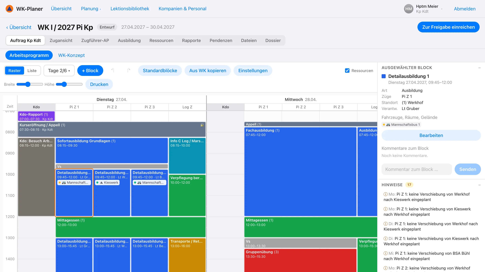
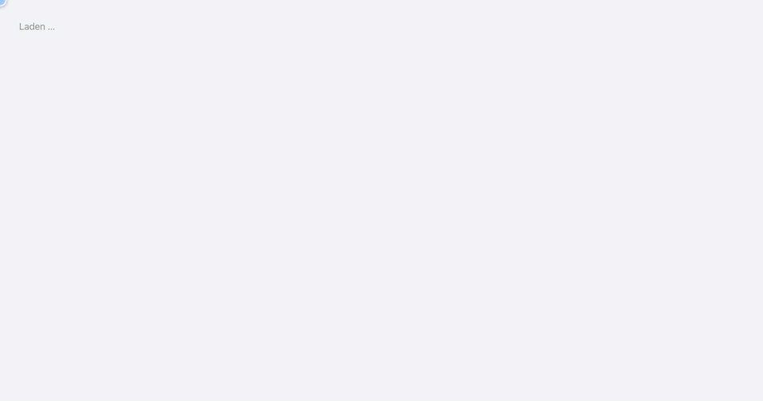
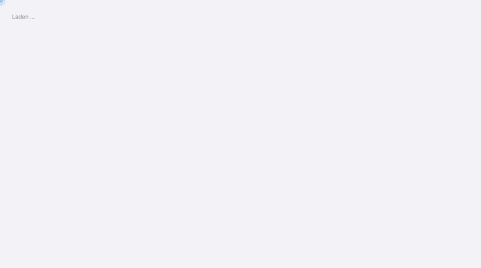

<div align="center">


# WK-Planer Protezione civile

**Pianificare i corsi di ripetizione della protezione civile svizzera – dall'ordine d'istruzione fino al check-in.**

[Deutsch](README.md) · [Français](README.fr.md) · **Italiano** · [English](README.en.md)

[](https://dllb-ch.github.io/WK-Planer/)
&nbsp;
[](LICENSE)


[Funzioni](#funzioni) · [Avvio rapido](#avvio-rapido) · [Installazione](INSTALL.it.md) · [Manuale (in tedesco)](docs/handbuch.md)

</div>

<br>

<picture>
  <source media="(prefers-color-scheme: dark)" srcset="docs/media/arbeitsprogramm-dark.webp">
  
</picture>

<br>

Realizzato secondo il *Manuale Condotta nella protezione civile* dell'Ufficio federale della protezione della
popolazione (UFPP). Più persone pianificano contemporaneamente, ogni ruolo con i propri diritti:

| 🎖️ Cdo bat | 🧭 Cdt cp | 📦 Uff log | 🗂️ Caposezione | 👥 Quadri |
|:---:|:---:|:---:|:---:|:---:|
| Ordine d'istruzione, pianificazione annuale, approvazione | Concetto del CR, programma di lavoro, personale | Logistica, richieste di veicoli e locali | Programma della propria sezione, lezioni | Leggere il proprio programma |

Funziona nel browser su computer, tablet e telefono, si installa come app, si usa in modalità chiara e scura e parla
tedesco, francese, italiano e inglese.

> [!TIP]
> **[Provare la demo nel browser →](https://dllb-ch.github.io/WK-Planer/)** – senza installazione e senza account:
> scegliere un ruolo e iniziare. La demo funziona interamente nel browser; le modifiche restano sul dispositivo.
> I dati demo sono in tedesco.

## Funzioni

### 📱 Check-in con codice QR

<table>
<tr>
<td width="62%" valign="middle">

Un codice QR per ogni giorno di servizio, da affiggere. I partecipanti fanno il check-in con il telefono – **senza
account, in pochi secondi** – e rispondono contemporaneamente all'interrogazione sanitaria d'entrata.

- Confronto con la lista dei partecipanti
- I pasti vengono contati (anche vegetariani)
- Le segnalazioni sanitarie arrivano al cdt cp
- Dal secondo giorno basta un tocco

</td>
<td width="38%" align="center">

</td>
</tr>
</table>

### 📅 Pianificazione annuale

I giorni di PL, CPQ e CR di tutte le compagnie di un anno. Nella vista mensile il comando del battaglione pianifica i
giorni trascinando il mouse come in un foglio di calcolo – per sezione, per funzione (capisezione, quadri, militi) o
per gruppo – con l'effettivo reale e quello regolamentare accanto.

<p align="center"></p>

### 🗓️ Programma di lavoro

Il programma di lavoro della compagnia come griglia: giorni con una colonna per sezione. I blocchi si disegnano, si
spostano e si allungano; i capisezione pianificano la loro sezione, il comando stabilisce blocchi fissi. Il menu del
clic destro duplica, copia al giorno successivo, blocca o richiede veicoli e locali. I conflitti vengono segnalati.

<p align="center"></p>

### 🚐 Veicoli, locali e terreni

I capisezione richiedono veicoli (secondo il numero di persone), locali e terreni per le loro fasce orarie; il cdt cp
approva e assegna. Il piano di occupazione mostra l'utilizzo e le doppie prenotazioni – anche tra le compagnie del
battaglione.

<p align="center"></p>

### 📝 Preparazione delle istruzioni e dossier

I capisezione preparano le loro lezioni direttamente nel blocco d'istruzione: obiettivi, livello d'istruzione, mezzi
e svolgimento secondo PITT – il controllo del tempo mostra se il programma rientra nella fascia oraria. Ne risulta il
dossier in PDF con intestazione: per la compagnia (frontespizio, mandato, concetto del CR, programma di lavoro,
risorse) o per sezione, con il programma di lavoro del caposezione e tutte le lezioni.

<p align="center"></p>

### 🌗 In movimento, chiaro e scuro

<table>
<tr>
<td width="38%" align="center">

</td>
<td width="62%" valign="middle">

Tutta l'app funziona anche sul telefono – con una vista a elenco del programma di lavoro, una navigazione adattata e
grandi elementi di comando.

- Installabile come app (PWA), leggibile offline
- Modalità chiara e scura secondo l'impostazione di sistema
- Stessi dati e stessi diritti che sul computer

</td>
</tr>
</table>

### 🌐 Deutsch, Français, Italiano, English

Tutta l'interfaccia esiste in quattro lingue, con i termini dei documenti dell'UFPP (p. es. WK / CR / CR, Kp Kdt /
cdt cp / cdt cp). Ogni account sceglie la propria lingua in «Il mio account»; l'accesso e il check-in si cambiano
direttamente, così i partecipanti fanno il check-in nella loro lingua.

- Le stampe come il dossier e l'ordine del giorno escono nella lingua di chi stampa
- Anche i messaggi del server, le trattande dei rapporti e i modelli seguono la lingua scelta
- I contenuti inseriti restano come sono stati registrati
- I termini utilizzati sono nel [glossario](docs/glossar.md)

### Inoltre

<table>
<tr>
<td width="33%" valign="top">

**🔗 Catena di pianificazione**<br>
Ordine d'istruzione → concetto del CR → programma di lavoro → programma di lavoro del caposezione, con calendario di
preparazione e pendenze per ruolo.

</td>
<td width="33%" valign="top">

**📚 Lezioni**<br>
Preparazioni delle istruzioni con obiettivi, svolgimento e controllo del tempo; biblioteca delle lezioni del
battaglione.

</td>
<td width="33%" valign="top">

**🧪 Esercitazioni**<br>
Ricognizioni, esercitazioni (concetto, copione, discussione) e ordine del giorno automatico.

</td>
</tr>
<tr>
<td valign="top">

**📝 Rapporti**<br>
Trattande secondo il manuale, verbale e pendenze.

</td>
<td valign="top">

**👥 Personale**<br>
Effettivo regolamentare per sezione e giorno, lista dei partecipanti da Excel, lista di presenza, gruppi per sezione.

</td>
<td valign="top">

**🖨️ Dossier**<br>
Tutti i documenti di un CR in PDF, con intestazione e logo propri.

</td>
</tr>
</table>

Lettura offline come app installata (PWA) – tutto il resto nel [manuale](docs/handbuch.md) (in tedesco).

## Avvio rapido

```bash
git clone https://github.com/dllb-ch/WK-Planer.git
cd WK-Planer
docker compose up -d --build
```

Aprire poi <http://localhost:8080> e accedere con `kpkdt@demo.ch` (password `zivilschutz`) – l'app parte con un CR
d'esempio e account demo per tutti i ruoli.

Oppure senza Docker, direttamente nel browser: [demo](https://dllb-ch.github.io/WK-Planer/).

Senza dati demo (senza `SEED_DEMO`) un assistente guida attraverso la
[prima configurazione](INSTALL.it.md#prima-configurazione): battaglione, compagnie e sezioni, account, risorse e
carta – in pochi minuti.

<p align="center"></p>

## Documentazione

- **[Installazione ed esercizio](INSTALL.it.md):** Docker, sviluppo, prima configurazione, server con HTTPS, impostazioni, test
- **[Manuale](docs/handbuch.md) (in tedesco):** tutte le funzioni e il loro uso, per ruolo

## Tecnica

- **Client:** React 18, TypeScript, Vite, TanStack Query, Tailwind CSS; installabile come PWA
- **Server:** Node.js, Express, zod, PostgreSQL (o PGlite)
- **Comune:** tipi e diritti in `shared/` – i diritti vengono verificati dal server e rispecchiati nel client
- **Lingue:** cataloghi tipizzati in `shared/i18n/` (de, fr, it, en); un test verifica che ogni lingua abbia ogni testo

```
client/   interfaccia (pianificatore: client/src/features/arbeitsprogramm/)
server/   API e banca dati (schema: server/src/sql/schema.sql)
shared/   tipi, diritti, regole di pianificazione, traduzioni
docs/     manuale e animazioni
```

## Contribuire

Errori e idee volentieri come issue, modifiche come pull request – con test (`npm test`) e controllo dei tipi
(`npm run typecheck`), vedi [INSTALL.it.md](INSTALL.it.md#test).

Il WK-Planer è un progetto indipendente e non un prodotto ufficiale dell'UFPP o di un Cantone.

## Licenza

[MIT](LICENSE)
