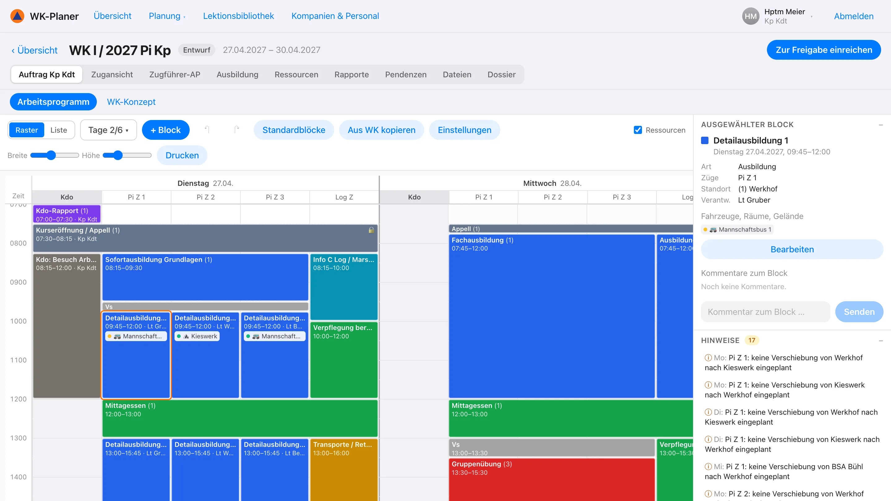
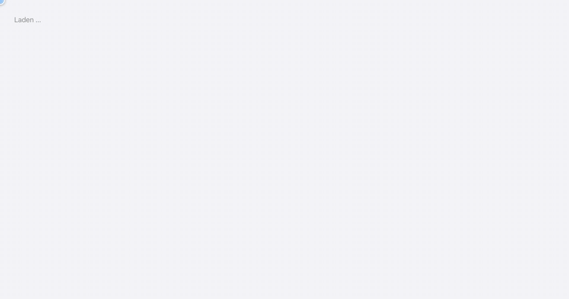

<div align="center">


# WK-Planer Zivilschutz

**Wiederholungskurse im Schweizer Zivilschutz planen – vom Ausbildungsbefehl bis zum Check-in.**

[](https://dllb-ch.github.io/WK-Planer/)
&nbsp;
[](LICENSE)


[Funktionen](#funktionen) · [Schnellstart](#schnellstart) · [Installation](INSTALL.md) · [Handbuch](docs/handbuch.md)

</div>

<br>

<picture>
  <source media="(prefers-color-scheme: dark)" srcset="docs/media/arbeitsprogramm-dark.webp">
  
</picture>

<br>

Aufgebaut nach dem *Handbuch Führung im Zivilschutz* des Bundesamts für Bevölkerungsschutz (BABS). Mehrere Personen
planen gleichzeitig, jede Rolle mit ihren eigenen Rechten:

| 🎖️ Bat Kommando | 🧭 Kp Kdt | 📦 Log Of | 🗂️ Zugführer | 👥 Kader |
|:---:|:---:|:---:|:---:|:---:|
| Ausbildungsbefehl, Jahresplanung, Freigabe | WK-Konzept, Arbeitsprogramm, Personal | Logistik, Anfragen für Fahrzeuge und Räume | Programm des eigenen Zugs, Lektionen | Eigenes Programm lesen |

Läuft im Browser auf Computer, Tablet und Handy, lässt sich als App installieren und funktioniert im hellen und
dunklen Modus.

> [!TIP]
> **[Demo im Browser ausprobieren →](https://dllb-ch.github.io/WK-Planer/)** – ohne Installation und ohne Konto:
> Rolle wählen und loslegen. Die Demo läuft vollständig im Browser; Änderungen bleiben auf dem eigenen Gerät.

## Funktionen

### 📱 Check-in per QR-Code

<table>
<tr>
<td width="62%" valign="middle">

Ein QR-Code pro Diensttag zum Aushängen. Die Teilnehmenden checken mit dem Handy ein – **ohne Konto, in wenigen
Sekunden** – und beantworten dabei die sanitarische Eintrittsbefragung.

- Abgleich mit der Teilnehmerliste
- Verpflegung wird gezählt (auch vegetarisch)
- Gesundheitsmeldungen gehen an den Kp Kdt
- Ab dem zweiten Tag genügt ein Tipp

</td>
<td width="38%" align="center">

</td>
</tr>
</table>

### 📅 Jahresplanung

AVOR-, KVK- und WK-Tage aller Kompanien eines Jahres. In der Monatsansicht plant das Bat Kommando Tage per
Mausziehen wie in einer Tabelle – pro Zug, pro Funktion (Zugführer, Kader, Soldaten) oder pro Gruppe – mit Ist-
und Sollbestand daneben.

<p align="center"></p>

### 🗓️ Arbeitsprogramm

Das Arbeitsprogramm der Kompanie als Raster: Tage mit je einer Spalte pro Zug. Blöcke werden gezeichnet, verschoben
und in der Länge verändert; Zugführer planen ihren Zug, das Kommando gibt fixe Blöcke vor. Das Rechtsklick-Menü
dupliziert, kopiert auf den nächsten Tag, fixiert oder fragt Fahrzeuge und Räume an. Konflikte werden angezeigt.

<p align="center"></p>

### 🚐 Fahrzeuge, Räume und Gelände

Zugführer fragen Fahrzeuge (nach Anzahl Personen), Räume und Gelände für ihre Zeitfenster an; der Kp Kdt bewilligt
und teilt zu. Der Belegungsplan zeigt Auslastung und Doppelbelegungen – auch über die Kompanien des Bataillons.

<p align="center"></p>

### Ausserdem

<table>
<tr>
<td width="33%" valign="top">

**🔗 Planungskette**<br>
Ausbildungsbefehl → WK-Konzept → Arbeitsprogramm → Zugführerarbeitsprogramm, mit Vorbereitungs-Zeitplan und
Pendenzen pro Rolle.

</td>
<td width="33%" valign="top">

**📚 Lektionen**<br>
Ausbildungsvorbereitungen mit Zielen, Ablauf und Zeitkontrolle; Lektionsbibliothek des Bataillons.

</td>
<td width="33%" valign="top">

**🧪 Übungen**<br>
Erkundungen, Übungen (Konzept, Drehbuch, Besprechung) und automatischer Tagesbefehl.

</td>
</tr>
<tr>
<td valign="top">

**📝 Rapporte**<br>
Traktanden nach Handbuch, Protokoll und Pendenzen.

</td>
<td valign="top">

**👥 Personal**<br>
Sollbestand pro Zug und Tag, Teilnehmerliste aus Excel, Präsenzliste, Gruppen pro Zug.

</td>
<td valign="top">

**🖨️ Dossier**<br>
Alle Unterlagen eines WK als PDF mit eigenem Briefkopf und Logo.

</td>
</tr>
</table>

Offline lesen als installierte App (PWA) – alles Weitere im [Handbuch](docs/handbuch.md).

## Schnellstart

```bash
git clone https://github.com/dllb-ch/WK-Planer.git
cd WK-Planer
docker compose up -d --build
```

Danach <http://localhost:8080> öffnen und mit `kpkdt@demo.ch` (Passwort `zivilschutz`) anmelden – die App startet
mit einem Beispiel-WK und Demo-Konten für alle Rollen.

Oder ohne Docker direkt im Browser: [Demo](https://dllb-ch.github.io/WK-Planer/).

## Dokumentation

- **[Installation und Betrieb](INSTALL.md):** Docker, Entwicklung, erste Einrichtung, Server mit HTTPS, Einstellungen, Tests
- **[Handbuch](docs/handbuch.md):** alle Funktionen und ihre Bedienung, nach Rolle

## Technik

- **Client:** React 18, TypeScript, Vite, TanStack Query, Tailwind CSS; installierbar als PWA
- **Server:** Node.js, Express, zod, PostgreSQL (oder PGlite)
- **Gemeinsam:** Typen und Berechtigungen in `shared/` – die Rechte werden im Server geprüft und im Client gespiegelt

```
client/   Oberfläche (Planer: client/src/features/arbeitsprogramm/)
server/   API und Datenbank (Schema: server/src/sql/schema.sql)
shared/   Typen, Berechtigungen, Planungsregeln
docs/     Handbuch und Animationen
```

## Mitmachen

Fehler und Ideen gerne als Issue, Änderungen als Pull Request – mit Tests (`npm test`) und Typprüfung
(`npm run typecheck`), siehe [INSTALL.md](INSTALL.md#tests).

Der WK-Planer ist ein unabhängiges Projekt und kein offizielles Produkt des BABS oder eines Kantons.

## Lizenz

[MIT](LICENSE)
